# Reglas del juego

## Contenido

- [Inicio de la partida](#inicio-de-la-partida)
- [Garantía de solubilidad](#garantia-de-solubilidad)
- [Objetivos](#objetivos)
- [Uso de los números](#uso-de-los-numeros)
- [Operaciones permitidas](#operaciones-permitidas)
- [Modo Hardcore](#modo-hardcore)
- [Resultados intermedios](#resultados-intermedios)
- [Validación de respuestas](#validacion-de-respuestas)
- [Pistas](#pistas)
- [Progreso y finalización](#progreso-y-finalizacion)
- [Tiempo y ranking](#tiempo-y-ranking)
- [Arquitectura y recursos](#arquitectura-y-recursos)

## Inicio de la partida

Antes de comenzar, el jugador selecciona el modo en el que desea jugar: **Normal** o **Hardcore**. Luego escribe un nickname e inicia la partida con el botón **Iniciar Partida** o presionando **Enter**.

  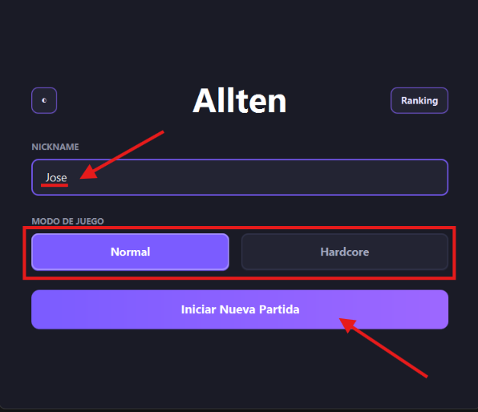

Desde la pantalla de inicio, también puede cambiar entre el tema claro y el oscuro con el botón **◐**, ubicado en la esquina superior izquierda.

  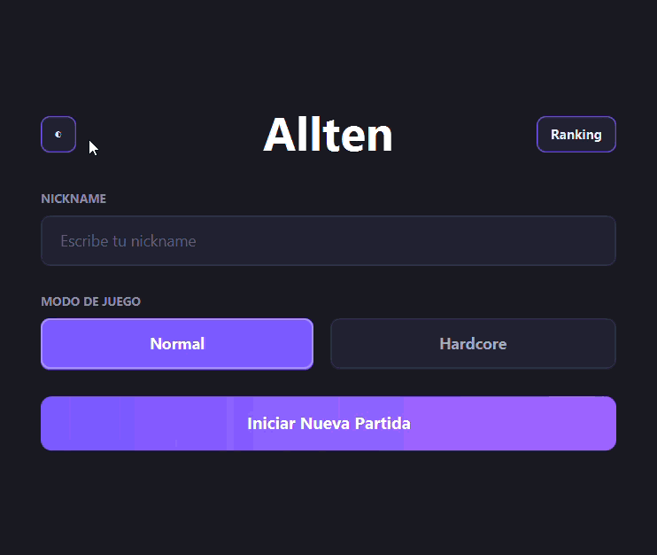

Al comenzar, el sistema genera cuatro números enteros aleatorios entre 1 y 9. Los números pueden repetirse. El mismo conjunto de cuatro números se mantiene durante toda la partida.

  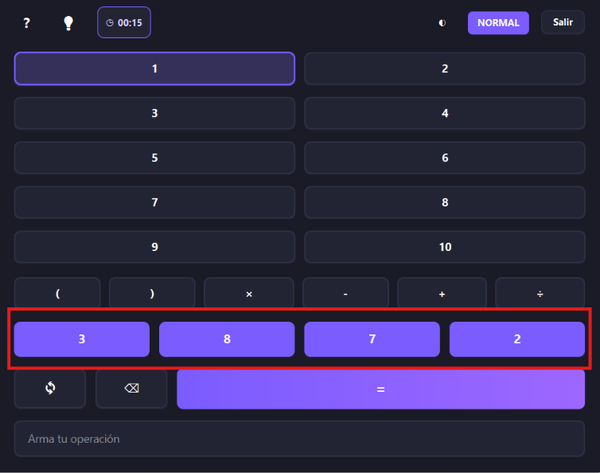

## Garantía de solubilidad

El sistema no acepta cualquier combinación aleatoria. Antes de iniciar la partida, aplica una búsqueda exhaustiva por fuerza bruta sobre las operaciones y agrupaciones posibles.

La combinación solo se utiliza si permite obtener todos los objetivos del 1 al 10. Si una combinación no permite resolver los diez objetivos, se descarta y se genera otra.

Por lo tanto, toda partida iniciada tiene solución para los diez objetivos.

## Objetivos

La partida contiene diez objetivos: los números enteros del 1 al 10.

  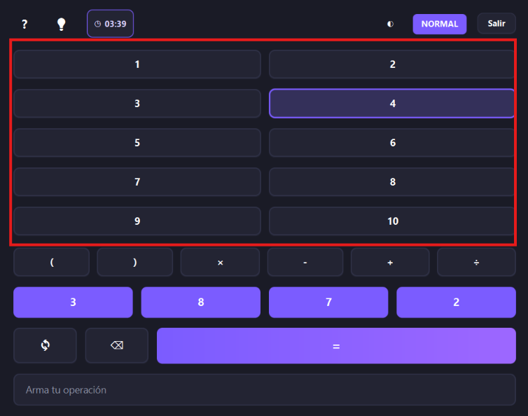

Los objetivos pueden resolverse en cualquier orden. El jugador puede comenzar por el 1, el 7, el 10 o cualquier otro objetivo pendiente. No existe una secuencia obligatoria.

  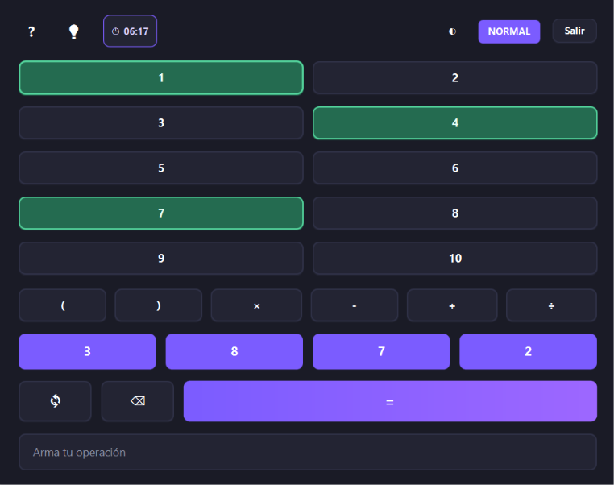

El objetivo se resolvió correctamente, como indica el color verde que se ve en la imagen.

Una expresión correcta se asigna automáticamente al objetivo cuyo resultado produce. No es obligatorio seleccionar primero la fila del objetivo.

## Uso de los números

Cada expresión debe utilizar los cuatro números generados para la partida, exactamente una vez cada uno.

Los números no se consumen entre objetivos. El mismo conjunto de cuatro números puede reutilizarse para resolver los diez objetivos.

Los botones de números se deshabilitan individualmente cuando el número correspondiente ya fue usado en la expresión actual. Si existen números repetidos, se pueden utilizar tantas copias como hayan sido generadas. Al borrar o reiniciar la expresión, los botones vuelven a habilitarse.

  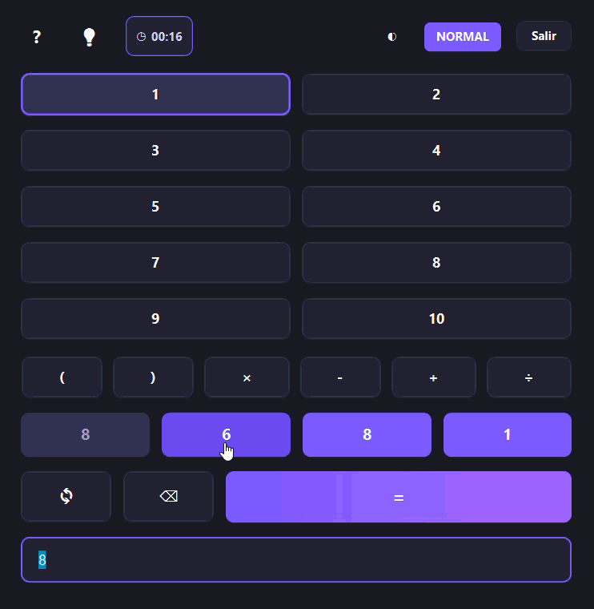

## Operaciones permitidas

Se permiten:

- suma (`+`);
- resta (`-` o `−`);
- multiplicación (`*` o `×`);
- división (`/` o `÷`);
- paréntesis.

  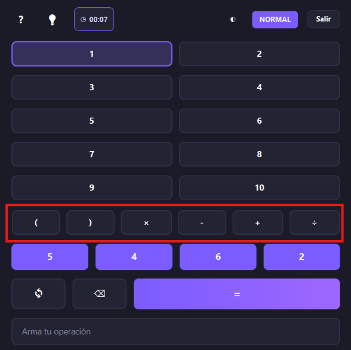

El teclado del juego muestra los operadores con sus símbolos visuales. Si el jugador escribe `*` o `/` en el teclado, la aplicación los muestra como `×` y `÷`.

La expresión se puede confirmar presionando el botón `=` o la tecla **Enter**.

  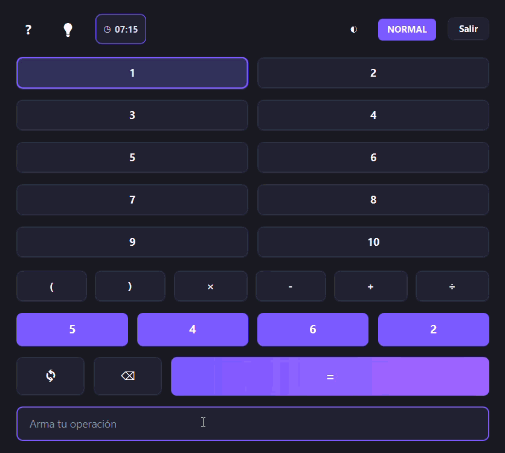

## Modo Hardcore

El modo Hardcore conserva las reglas principales de la partida: cuatro números del 1 al 9, los objetivos del 1 al 10 y el uso de cada número exactamente una vez por expresión. También mantiene el cronómetro y los intentos ilimitados.

Además de las operaciones básicas y los paréntesis, permite:

- potencia (`^`);
- raíz cuadrada (`√`), aplicada únicamente a valores no negativos y como máximo una vez por expresión.

Cada expresión debe incluir al menos una operación avanzada **no trivial**: una potencia cuyo exponente no sea 0 ni 1, o una raíz cuadrada cuyo radicando sea mayor que 1. Así, expresiones como `3^1` o `√1` no cumplen el requisito.

Se permiten resultados intermedios fraccionarios y negativos. La expresión debe ser matemáticamente válida, producir un resultado real y finito, no dividir entre cero y resolver exactamente un objetivo pendiente.

Antes de iniciar una partida Hardcore, la combinación de números debe comprobarse con estas mismas reglas y permitir resolver los diez objetivos. El ranking Hardcore se mantiene separado del ranking Normal.

El modo Hardcore se puede seleccionar e iniciar desde la interfaz del juego.

  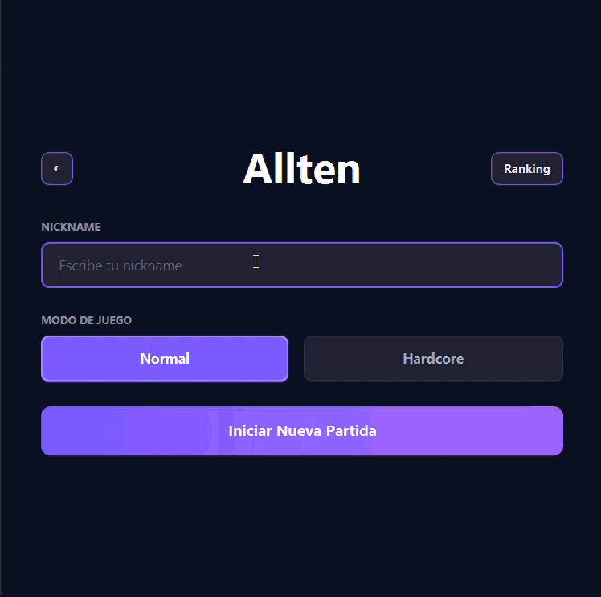

## Resultados intermedios

Se permiten resultados intermedios fraccionarios y negativos, siempre que el resultado final sea exactamente uno de los objetivos del 1 al 10.

No se permite dividir entre cero ni utilizar operadores o paréntesis con una sintaxis inválida.

## Validación de respuestas

Una expresión es correcta cuando:

- utiliza únicamente los cuatro números generados;
- usa cada número exactamente una vez;
- utiliza solo operaciones permitidas;
- tiene una sintaxis matemática válida;
- no divide entre cero; y
- produce exactamente uno de los objetivos pendientes.

Si la expresión utiliza números incorrectos o repite un número cuya copia ya no está disponible, se muestra un mensaje que indica que deben usarse los cuatro números disponibles exactamente una vez.

Si la expresión tiene una operación o estructura inválida, se muestra un mensaje que indica que la operación matemática no es válida.

Si la expresión es válida, pero produce un resultado que no corresponde a una solución pendiente, se muestra el resultado obtenido. Por ejemplo: **El resultado 12 no forma parte de las soluciones.**

## Pistas

Al consultar una pista, el juego muestra una expresión válida para el objetivo seleccionado, generada con los números de la partida y las reglas del modo activo. La expresión se puede copiar desde el diálogo y pegar en el campo de entrada con `Ctrl+V`. En Hardcore, la pista incluye una potencia o raíz cuadrada no trivial y respeta el límite de una raíz por expresión.

## Progreso y finalización

Cada objetivo resuelto se marca visualmente en verde y conserva la expresión utilizada. El orden visual de las soluciones representa el orden en que el jugador las completó.

  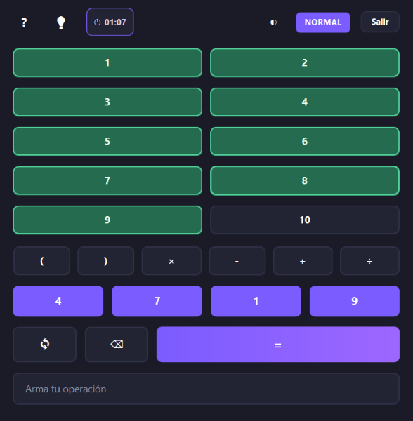

La partida termina cuando los diez objetivos están resueltos, sin importar el orden.

Al finalizar, se muestra una pantalla de resumen dentro de la aplicación con el tiempo total empleado.

  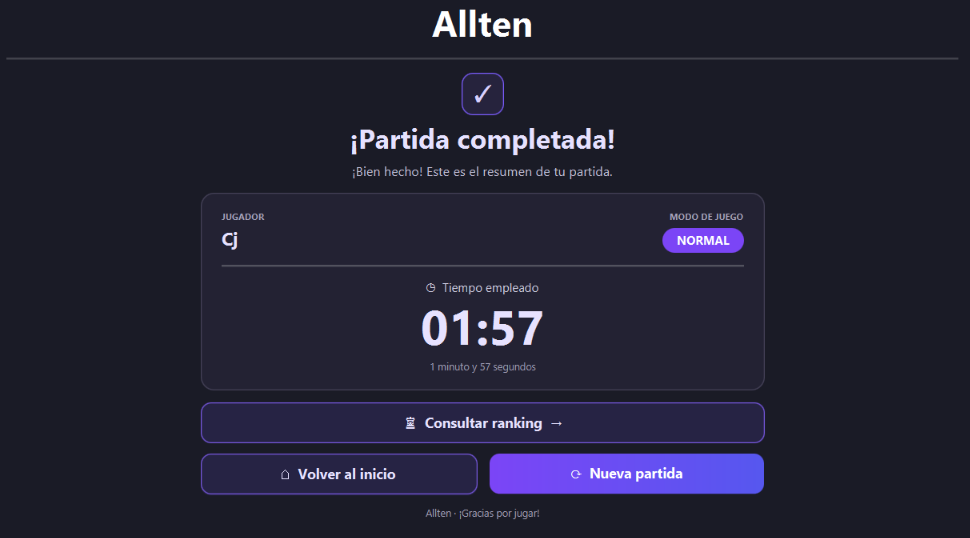

## Tiempo y ranking

El cronómetro comienza al iniciar la partida y se detiene al resolver el décimo objetivo.

El ranking se ordena por el menor tiempo total. Si dos jugadores tienen el mismo tiempo, se desempata con el menor número de intentos. Las partidas abandonadas o incompletas no se incluyen.

  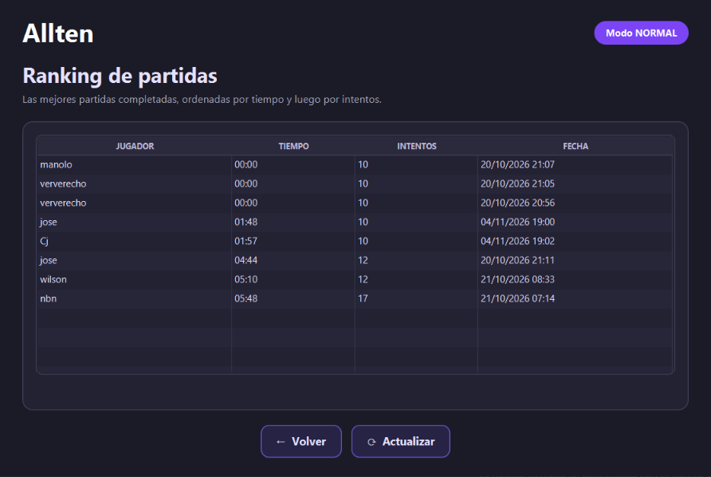

Desde el resumen de la partida, el jugador puede consultar el ranking o volver a la pantalla de inicio.

  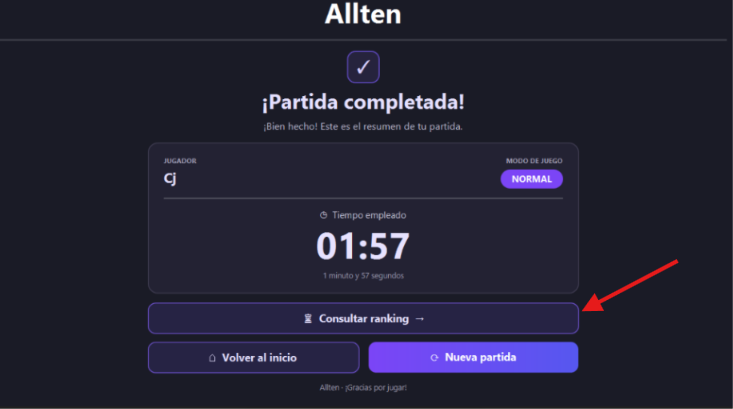

  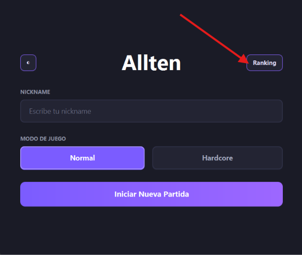

## Arquitectura y recursos

La aplicación sigue el patrón MVC:

- el modelo administra las reglas, la sesión, los objetivos, la validación, el tiempo y el ranking;
- el controlador conecta las acciones de la vista con el modelo;
- la vista carga FXML, aplica CSS y muestra el estado al jugador.

Las pantallas están separadas en recursos:

- `game-home.fxml` y `game-home.css` para el inicio;
- `game.fxml` y `game.css` para la partida;
- `game-summary.fxml` para el resumen final.
